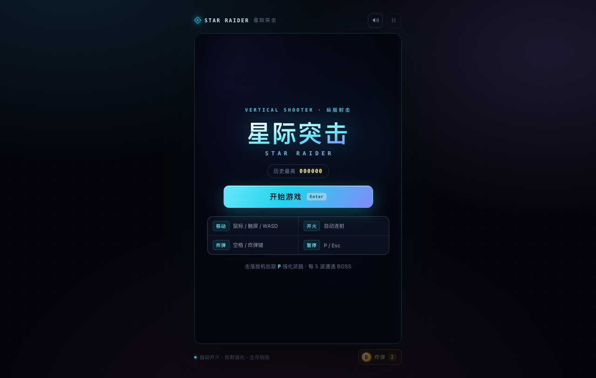
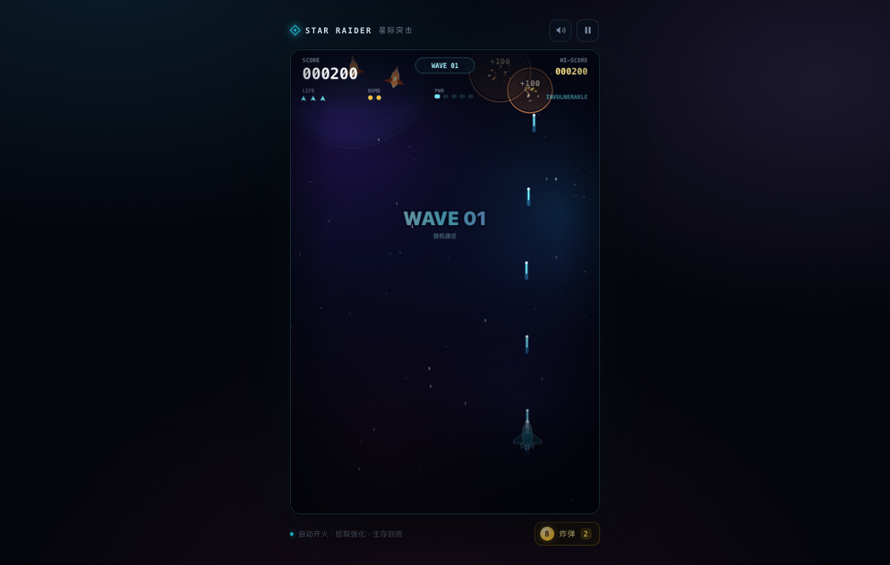
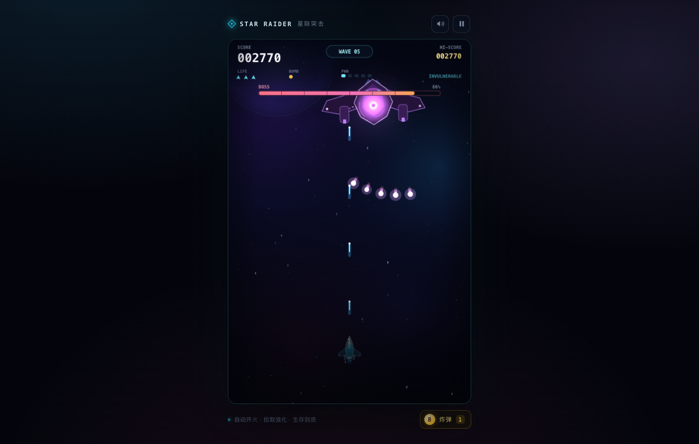
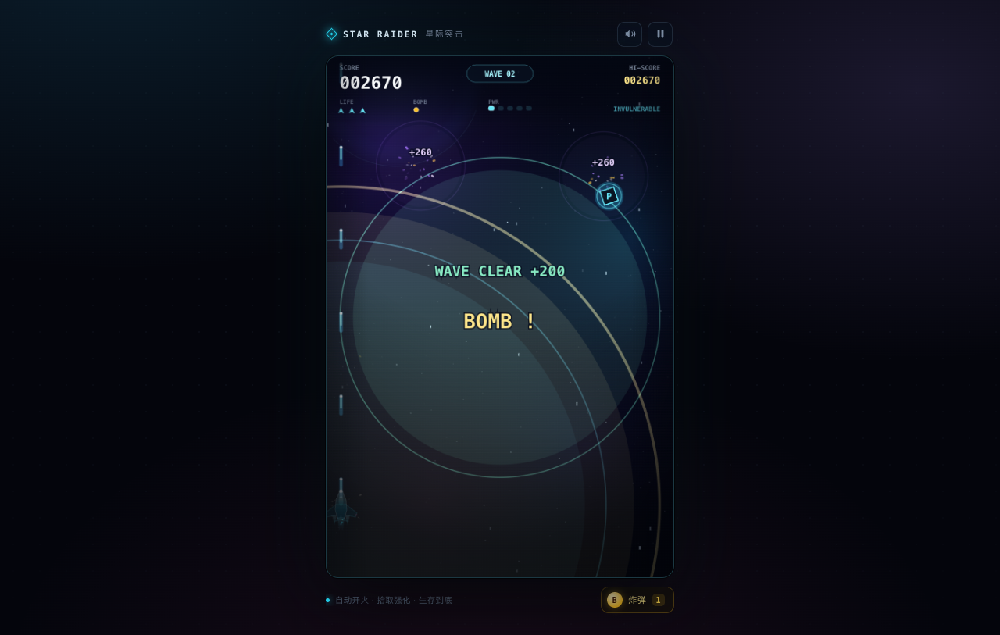
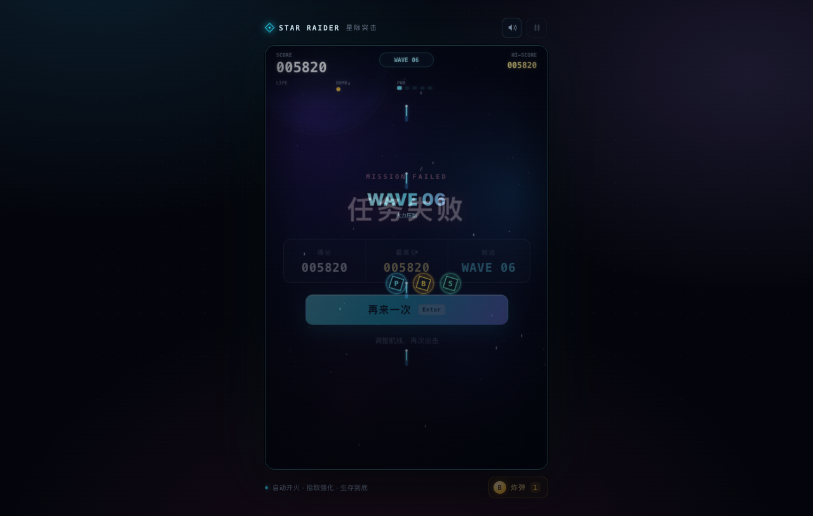
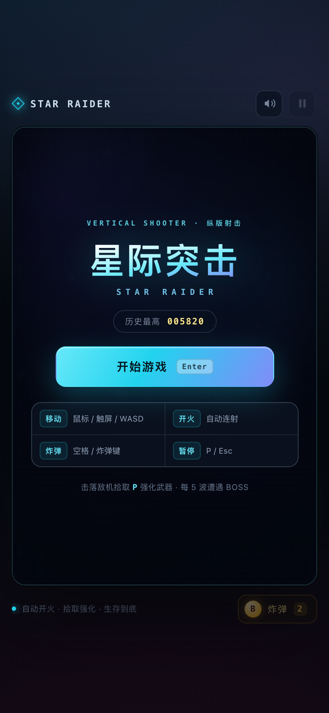
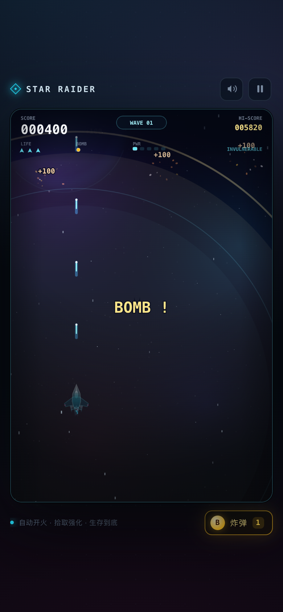

# 星际突击 · STAR RAIDER

一个可离线游玩的竖版射击小游戏。青白色战机、霓虹星空、自动连射、强化补给，每 5 波挑战毁灭者级 BOSS。

**零依赖 · 无构建 · 无网络请求 · 双击即玩**



## 快速开始

1. 双击 `index.html`（或把它拖进 Chrome / Edge / Safari）。
2. 点击「开始游戏」。
3. 移动战机、自动开火、捡补给、打 BOSS。

> 项目使用经典 `<script>` 标签而非 ES Module，因此不需要本地服务器，`file://` 直接打开即可运行。所有图形与音效都由 Canvas / WebAudio 实时生成。

## 操作

| 操作 | 方式 |
| --- | --- |
| 移动 | 移动鼠标 / 触屏拖动 / 方向键 / WASD |
| 开火 | 自动连射 |
| 炸弹 | `空格` 或右下角「炸弹」按钮（清屏 + 全屏伤害） |
| 暂停 | `P` / `Esc` / 顶栏暂停键 |
| 静音 | `M` / 顶栏喇叭键 |
| 开始 / 重开 | 点击按钮 / `Enter` |

触屏拖动时，战机会自动抬到手指上方，避免被手指遮住。

## 玩法

- **敌机**：侦察机（横向漂移）、俯冲机（锁定俯冲）、炮艇（瞄准射击）、重装坦克（三向散射）。
- **补给**：
  - `P` 火力 +1（最多 5 级，弹道更多）
  - `B` 炸弹 +1
  - `S` 护盾 7 秒
  - `H` 生命 +1
- **波次**：清空当前波后自动进入下一波，并获得 `波次 × 100` 分；每 5 波出现 BOSS。
- **BOSS**：血量随波次增长，拥有瞄准弹、旋转环形弹、连发点射和交叉弹幕；血量低于 40% 狂暴。
- **生命**：初始 3 条命，死亡后清空敌弹并短暂无敌；生命耗尽进入结算。
- **最高分**：保存在浏览器 `localStorage` 中（Chrome 的 `file://` 环境实测可用）。

## 文件结构

```
index.html              页面入口与菜单 DOM
css/style.css           布局、霓虹视觉、响应式
js/config.js            全局参数
js/utils.js             工具函数
js/audio.js             WebAudio 音效合成
js/input.js             键盘 / 鼠标 / 触屏输入
js/entities.js          星空、子弹、敌机、BOSS、补给、粒子
js/player.js            玩家战机与武器
js/game.js              主循环、波次、碰撞、HUD、状态机
js/main.js              启动入口 / 调试接口
assets/favicon.svg      本地图标
verification/           真实浏览器验证脚本、报告与截图
```

## 截图

| 游戏进行 | BOSS 战 |
| --- | --- |
|  |  |

| 炸弹清屏 | 任务结算 |
| --- | --- |
|  |  |

移动端（390×844）：

<p>
  
  
</p>

## 真实浏览器验证

已在 **Chrome 157（headless，`file://` 直接打开）** 中完成 57 项自动化检查，全部通过：

- 真实鼠标移动 / 键盘按键 / 触屏拖动均能操控战机；
- 自动开火击落敌机、获得分数；炮艇与 BOSS 均能正常发射弹幕；
- 敌方子弹真实碰撞、护盾吸收、扣命与重生均正常；
- 暂停 / 继续、炸弹、补给拾取、BOSS 击破、死亡结算、重开均正常；
- 最高分写入并跨刷新保留；
- 桌面与 390×844 移动视口无溢出；
- 实测约 **60fps**；控制台 0 error、0 未捕获异常、0 外部网络请求；
- 另外测试了**不带任何调试参数**的纯 `index.html` 双击场景。

复跑验证（需要 Node 24+ 与 Chrome）：

```bash
node verification/verify.mjs
```

详细结果见 [`verification/VERIFICATION.md`](verification/VERIFICATION.md)，截图在 [`verification/screenshots/`](verification/screenshots/)，原始报告见 [`verification/browser-report.json`](verification/browser-report.json)。

## 技术说明

- 逻辑分辨率 480×720，按 `devicePixelRatio`（上限 2）放大 backing store，高分屏清晰。
- 舞台使用 CSS 计算尺寸保持 2:3 比例，页面不产生滚动；移动端支持安全区与触屏拖动。
- 主循环帧率无关，`dt` 上限 1/30 秒；页面切后台会自动暂停。
- 所有音效为实时合成，没有外部音频与图片资源。
- 打开 `index.html?debug=1` 会额外暴露 `window.__SR_DEBUG`，仅用于自动化验证。

## 兼容性

推荐使用最新版 Chrome / Edge / Safari。需要支持 Canvas 2D、Pointer Events、WebAudio 与 CSS 容器查询（2022 年后的主流浏览器均已支持）。

---

祝你通关。若被打下来，别怪 BOSS 不讲武德。
